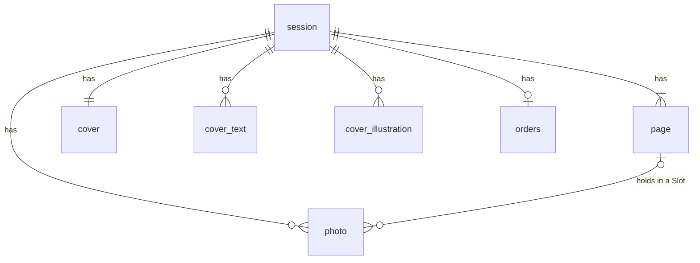

# Database

## Status

Approved by the user on 2026-11-24. The grilling session of the same day settled every decision below. On the same day the user chose PostgreSQL with TypeORM instead of SQLite. The backend scaffold exists in `api/`. No entity is implemented yet.

## Goal

The backend keeps the work of one user in a relational database. There are no accounts. The URL holds the Session id. Any device that opens the URL edits the same photobook, for example a phone and a computer.

The database is PostgreSQL, accessed through TypeORM (see [ideas.md](ideas.md), Backend). Migrations create the schema: `synchronize` stays off.

### Types

The tables below use SQLite-style type names. Map them in PostgreSQL:

| Spec | PostgreSQL |
| --- | --- |
| `INTEGER` (counters, sizes, pixels) | `integer` |
| `INTEGER PK` | `integer generated always as identity` |
| `INTEGER` for 0 or 1 | `boolean` |
| `INTEGER` for Unix seconds | `timestamptz` |
| `REAL` | `double precision` |
| `TEXT` | `text` |

PostgreSQL enforces foreign keys always. A column that holds a time keeps the name from the spec (`created_at`, `expires_at`).

## Out of scope

- The backoffice (see [ideas.md](ideas.md), Operations). It will reopen a locked Session and change `expires_at`.
- The Quick preview. The frontend builds it from the light copies of the Photos. The backend does not build or store it.
- Payment. The payment provider keeps the payment data.

## Session

- A Session is one photobook in progress.
- The Session id is a random token of at least 128 bits, in base64url (22 characters). It is the only secret. Anyone with the URL can edit the Session.
- The id is not a counter. A counter id lets a visitor guess other Sessions.
- The browser also keeps the id in local storage, so a user who closes the tab can return.

### Version

`session.version` is a counter. Each edit adds 1 to it. The frontend sends the `version` it last read with each edit. If the stored `version` is different, the backend rejects the edit. The frontend then reads the Session again.

This stops two devices from overwriting each other without notice.

- An edit of a Page, a Slot, the Cover or a text checks and adds 1 to `version`.
- A Photo upload does not check `version` and does not add 1 to it. An upload never overwrites anything.

### Status

`session.status` has two values:

- `editing`: the user can edit.
- `locked`: the Session is read-only. The backend rejects every write, including a Photo upload.

A payment locks the Session. The backoffice can set it to `editing` again, for example after a printing problem.

### Expiry

| Session | `expires_at` |
| --- | --- |
| Not paid | One month after the last write. Each write moves it forward. |
| Paid | `NULL`. The Session is not purged. Only the backoffice deletes it. |

A paid Session keeps its Photos and its Print PDF so that the backoffice can reopen it.

## Tables

Every table except `session` has `session_id`. A Session delete removes all its rows (`ON DELETE CASCADE`). The purge job also removes the files.

### session

| Column | Type | Notes |
| --- | --- | --- |
| `id` | TEXT PK | The token above. |
| `product_id` | TEXT NOT NULL | `route` or `moment`. Products live in code (`app/src/lib/products.ts`), not in a table. |
| `version` | INTEGER NOT NULL DEFAULT 0 | See Version. |
| `status` | TEXT NOT NULL DEFAULT `editing` | `editing` or `locked`. |
| `created_at` | INTEGER NOT NULL | Unix seconds. |
| `last_seen_at` | INTEGER NOT NULL | Shows how often users return. The backend writes it at most once per hour per Session. |
| `expires_at` | INTEGER NULL | See Expiry. |

The number of Pages is not a column. It is the number of `page` rows of the Session.

### photo

A Photo has a placement when it sits in a Slot. A Photo without a placement shows in the Asset panel.

| Column | Type | Notes |
| --- | --- | --- |
| `id` | INTEGER PK | |
| `session_id` | TEXT NOT NULL FK | |
| `name` | TEXT NOT NULL | The original file name. |
| `file_path` | TEXT NOT NULL | Relative path on the server disk, for example `photos/<session_id>/<id>.jpg`. The API builds the URL. |
| `width` | INTEGER NOT NULL | Pixels. |
| `height` | INTEGER NOT NULL | Pixels. |
| `byte_size` | INTEGER NOT NULL | For the Session limit. |
| `created_at` | INTEGER NOT NULL | |
| `page_number` | INTEGER NULL | Placement. |
| `slot_index` | INTEGER NULL | Placement. The place of the Slot in its Template. |
| `position_x` | REAL NULL | Placement. 0 to 1. A new placement starts at 0.5. |
| `position_y` | REAL NULL | Placement. 0 to 1. A new placement starts at 0.5. |
| `zoom` | REAL NULL | Placement. 1 to 3. A new placement starts at 1. |

Constraints:

- `CHECK`: the five placement columns are all `NULL` or all set.
- Partial `UNIQUE` on (`session_id`, `page_number`, `slot_index`) where `slot_index` is not `NULL`. A Slot holds one Photo.
- Foreign key (`session_id`, `page_number`) to `page`.

The database does not know how many Slots a Template has. The backend checks that `slot_index` is lower than the `slotCount` of the Template. An empty Slot has no row.

A swap of two Photos is three writes in one transaction: clear the first placement, move the second, set the first.

Index: `photo(session_id)`.

#### Limits

One Session holds at most **150 Photos** and **1 GB**. The backend rejects an upload that passes a limit. These are starting numbers. Adjust them when Grafana shows the size of real Sessions.

#### Files

- The Photo file is on the server disk, not in the database.
- The backend keeps one file per Photo, at print quality (see [ideas.md](ideas.md), Backend).
- The editor loads a light copy. The backend builds it on the first request with ImageMagick and keeps it in a cache folder. The database does not know the cache. The backend can empty the folder and build the copies again.

### page

One row per Page. The Cover and the Back cover are not here.

| Column | Type | Notes |
| --- | --- | --- |
| `session_id` | TEXT NOT NULL FK | |
| `number` | INTEGER NOT NULL | 1 to the page count of the Product. |
| `template_id` | TEXT NOT NULL | A Template id from code (`single`, `stacked`, ...). |
| `margins` | TEXT NOT NULL | `framed` or `full-bleed`. |

Primary key: (`session_id`, `number`). The backend creates all Page rows when it creates the Session.

When the user changes the Template of a Page, the backend clears the placement of each Photo whose Slot no longer exists. The Photo stays in the Session.

### cover

| Column | Type | Notes |
| --- | --- | --- |
| `session_id` | TEXT PK FK | One Cover per Session. |
| `color_scheme_id` | TEXT NOT NULL | An id from code (`colorSchemes.ts`). |

The Back cover has no table. The backend builds it the same for every Session, with the color of this row.

### cover_text

The Title and the Date line. Two rows at most. A Text template can create a missing one (see [text-templates](text-templates.md)).

| Column | Type | Notes |
| --- | --- | --- |
| `session_id` | TEXT NOT NULL FK | |
| `kind` | TEXT NOT NULL | `title` or `date_line`. |
| `text` | TEXT NOT NULL | |
| `edited` | INTEGER NOT NULL | 0 or 1. If 0, a new language translates the text. |
| `typeface` | TEXT NOT NULL | |
| `x`, `y`, `width`, `height` | REAL NOT NULL | Fractions of the sheet width. |
| `letter_size` | REAL NOT NULL | |
| `line_spacing` | REAL NOT NULL | A multiple of the Letter size. |
| `letter_spacing` | REAL NOT NULL | Thousandths of an em. |
| `underline` | INTEGER NOT NULL | 0 or 1. |
| `strikethrough` | INTEGER NOT NULL | 0 or 1. |
| `alignment` | TEXT NOT NULL | `left`, `center` or `right`. |

Primary key: (`session_id`, `kind`). The columns follow `CoverText` in `app/src/lib/cover.ts`.

### cover_illustration

| Column | Type | Notes |
| --- | --- | --- |
| `id` | INTEGER PK | Replaces the `key` of the frontend. |
| `session_id` | TEXT NOT NULL FK | |
| `illustration_id` | TEXT NOT NULL | An Illustration id from code. |
| `x`, `y`, `width`, `height` | REAL NOT NULL | Fractions of the sheet width. |
| `max_width` | REAL NOT NULL | |
| `layer` | INTEGER NOT NULL | Draw order. A higher number is on top. |

Index: `cover_illustration(session_id)`.

### orders

The table is `orders` because `order` is a reserved word in SQL. The backend creates the row when the user pays. A Session has one Order. A reprint after a printing problem uses the same Order.

| Column | Type | Notes |
| --- | --- | --- |
| `id` | INTEGER PK | |
| `session_id` | TEXT NOT NULL FK UNIQUE | |
| `email` | TEXT NOT NULL | |
| `name` | TEXT NOT NULL | |
| `phone` | TEXT NOT NULL | |
| `shipping_address` | TEXT NOT NULL | |
| `paid_at` | INTEGER NOT NULL | Unix seconds. |
| `print_pdf_path` | TEXT NULL | Relative path of the Print PDF on the server disk. |

The Session has no payment column. The Order tells that the user paid.

## Relations

## Rules for the backend

- **Session creation**: insert `session`, all `page` rows, one `cover` and its default `cover_text` rows, in one transaction.
- **One edit, one transaction**: check `status` and `version`, apply the change, add 1 to `version`, move `expires_at` forward.
- **Photo upload**: check `status` and the Session limits. Do not check `version`.
- **Photo delete**: the trash deletes the Photo for good. Delete the row, then the file and its light copy. If a file delete fails, the purge job removes it later. To take a Photo out of a Slot, the user drags it to the Asset panel. That clears the placement and keeps the Photo.
- **Payment**: in one transaction, insert the Order, set `status` to `locked` and set `expires_at` to `NULL`. Then build the Print PDF and write its path to the Order.
- **Reprint**: the backoffice sets `status` to `editing`. When the Session is locked again, the backend builds a new Print PDF and replaces `print_pdf_path`. There is no second payment.
- **Purge**: a job deletes the Sessions with `expires_at` in the past, then their files.
- **Photo reads**: the API returns a URL to the file, never the file bytes.
- **`last_seen_at`**: write it only if the stored value is more than one hour old.

## Terms

Session, Order and Print PDF are in `GLOSSARY.md`.
